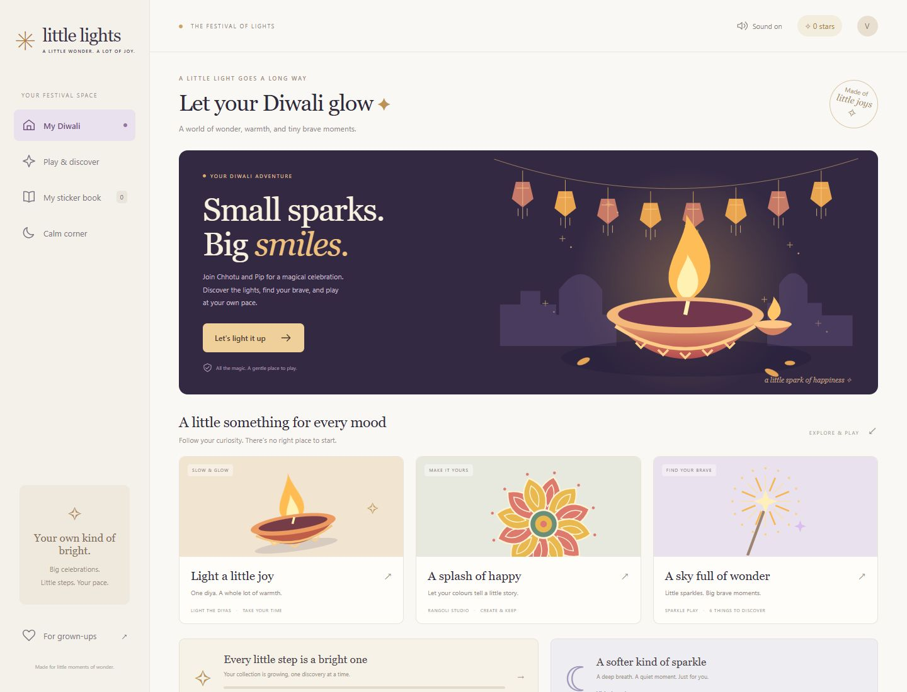

# 🪔 Little Lights — The Diwali Courtyard
### *Chhotu Champ's Diwali Glow*

> A gentle, therapeutic, and sensory-friendly HTML5 celebration designed to help children explore the wonder of Diwali and build confidence around fireworks at their own pace.



---

## 🌟 Overview

Many children love the colours and excitement of Diwali but can feel overwhelmed by sudden loud noises and unpredictable firecrackers. **Little Lights** provides a safe, welcoming virtual playground where kids take full control:

- **No Surprise Bangs**: Every firework follows a structured, predictable routine.
- **Audio Control in Your Hands**: Adjust the master volume or choose between **Gentle**, **Natural**, and **Full** sound intensities directly in the top navigation bar.
- **Instant Breathing Breaks**: A single tap on **"Take a breath"** pauses the courtyard anytime to breathe alongside Pip the puppy.
- **100% Procedural & Offline**: Pure HTML5 Canvas 2D visuals and Web Audio API synthesis with zero external audio/image asset downloads.

---

## ✨ Features

### 🏛️ 1. Festival Home
A warm editorial homepage welcoming young explorers and families:
- **Light a Little Joy (Diyas)**: Interactive 5-diya lighting activity with warm golden glows.
- **Rangoli Studio**: Design your own festive rangoli with custom colors and export as high-resolution SVG.
- **My Sticker Book**: Track collected memories as you discover each spark in the adventure.
- **For Grown-ups**: Parental guidance notes on sensory sensitivity, pretend fireworks, and safety habits.

### 🎆 2. The Diwali Courtyard
An interactive moonlit courtyard featuring **Chhotu Champ** and his curious puppy **Pip**:
- **Authentic Indian Heritage Setting**: Intricate havelis (Jaipur Rose, Jodhpur Blue, Sandstone Gold), glowing jharokha windows, clay diyas, akash kandil lanterns, and an open wire-free sky for firework displays.
- **Chalk Safety Ring & Durrie**: Cracker props stand out clearly on the street's chalk ring, while Chhotu and Pip watch safely from a traditional embroidered rug (Safe Zone).

### 🧨 3. The 6 Celebratory Fireworks
Each firework introduces gentle sensory steps from soft sparkles to grand celebrations:
1. **Phuljhari (Sparkler)** 🌟 — Soft golden sizzles and crackles in hand.
2. **Anar (Flower Pot)** 🌋 — A rising golden fountain of colorful sparks with a gentle whistle.
3. **Chakri (Ground Spinner)** 🌀 — A whirling disc of spinning embers gliding across the street.
4. **Rocket (Sky Shot)** 🚀 — Ascending rocket whistle into a vibrant celestial sky burst.
5. **Ladi (Garland Crackers)** 🎊 — A festive garland popping rhythmically in safe, controlled sequences.
6. **Sutli Bomb** 💥 — A grand, colorful finale celebrating courage and bright moments.

### 🛡️ 4. The 5-Step Safety Routine
Every cracker follows the exact sequence children learn for real-world firework safety:
1. **Select**: Choose an unlocked firework from the bottom dock.
2. **Place on Street**: Placed safely on the road launchpad (away from doorways).
3. **Light with Sparkler**: Tap "Light the fuse" — Chhotu reaches forward with his sparkler to touch the fuse.
4. **Step Back & Cover Ears**: Chhotu and Pip walk back to the Safe Zone, cover their ears, and count down `3... 2... 1...`.
5. **Celebrate**: Fireworks burst in the open sky, followed by reward stars and a collectible sticker.

### 🧘 5. Calm Corner & Emotional Regulation
- The **"Ⅱ Take a breath"** button in the top navigation bar instantly suspends game animations and transitions into a peaceful breathing circle with Pip.
- Soft ambient tanpura/bansuri pad chords soothe the senses.
- Automatic safety pause activates if the user switches browser tabs or resizes the screen.

---

## 🛠️ Tech Stack

- **Framework**: [React 18](https://react.dev/) + [Vite](https://vitejs.dev/)
- **Visuals**: Procedural HTML5 Canvas 2D (layered render passes, particle engine, character rigs, jelly squash FX)
- **Audio**: Procedural [Web Audio API](https://developer.mozilla.org/en-US/docs/Web/API/Web_Audio_API) (synthesized pink noise, resonance filters, harmonic oscillators, master dynamics compressor/limiter)
- **State Management**: React Context (`GameStore`) + Finite State Machine (`GameController`)
- **Persistence**: `localStorage` (`chhotu_diwali_save_v1`)
- **Testing**: [Vitest](https://vitest.dev/) (155 unit tests)

---

## 🚀 Getting Started

### Prerequisites
- Node.js (v18 or higher recommended)
- npm or yarn / pnpm

### Installation

```bash
# Clone the repository
git clone https://github.com/your-username/happy-diwali.git
cd happy-diwali

# Install dependencies
npm install
```

### Development

```bash
# Start local development server with HMR
npm run dev
```

Visit `http://localhost:5173` in your browser.

### Production Build

```bash
# Build optimized self-contained bundle
npm run build

# Preview production build locally
npm run preview
```

The production output is generated in `dist/`.

### Testing

```bash
# Run Vitest test suite once
npm test

# Run Vitest in watch mode
npm run test:watch
```

---

## 📁 Project Structure

```
happy-diwali/
├── docs/                   # Architectural plans, requirements, and design specifications
│   ├── implementation-plan.md
│   ├── requirements.md
│   ├── tasks.md
│   └── little-lights-preview.png
├── src/
│   ├── audio/              # Procedural Web Audio synthesis (SoundEngine, FireworkSound)
│   ├── crackers/           # Firework definitions, controllers, and reward confetti
│   ├── fsm/                # GameController finite state machine
│   ├── render/             # Canvas 2D engine (Particles, Renderer, Layers, Characters)
│   │   ├── characters/     # Procedural rigs for Chhotu Champ and Pip
│   │   ├── fx/             # Comic bubbles and jelly squash animations
│   │   └── layers/         # Background, Haveli architecture, and Courtyard layout
│   ├── store/              # gameStore context and localStorage persistence
│   ├── ui/                 # React UI components (HUD, Carousel, Modals, FestivalHome)
│   ├── App.jsx             # Top-level application shell and view router
│   ├── festival.css        # FestivalHome styling
│   ├── gameplay.css        # Courtyard HUD, Dock, and Navigation bar styling
│   └── main.jsx            # Application entry point
├── test/                   # Vitest unit test suite (155 tests)
├── index.html              # HTML entry template
├── vite.config.js          # Vite configuration
├── package.json
└── README.md
```

---

## 🔒 Safety & Disclaimer

*Little Lights is a playful, virtual celebration created for emotional comfort, discovery, and festive cheer. Real-world fireworks must always be handled solely by responsible adults with children watching safely from a distance with proper ear and eye protection.*

---

## 📜 License

Created with care for little moments of wonder. Happy Diwali! 🪔✨
