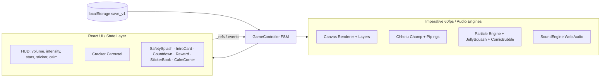

# Chhotu Champ's Diwali Glow — Implementation Plan

## Problem Statement

Build a zero-runtime-asset, offline HTML5 Canvas + Web Audio game that guides children (5–8) through a predictable, fear-reducing firecracker routine, with 6 crackers of escalating intensity, a Calm Corner escape hatch, three tamed audio intensity tiers, procedural visuals/particles, and persistent sticker/star progression.

## Tech Stack (Confirmed)

- **Vite + React 18** with JSX (JavaScript, per spec's "ES6+ JavaScript").
- **Vitest** for lightweight logic tests (dev-only dependency, not part of shipped build).
- No external images/audio/fonts. All visuals via Canvas/CSS/inline SVG; all audio via Web Audio synthesis.
- The Canvas render engine, particle system, character rigs, and SoundEngine are framework-agnostic vanilla JS classes that React mounts and orchestrates. React owns UI/state flow; engines do the 60fps/realtime-audio work.
- Portrait-first 9:16, `viewport-fit=cover` + safe-area insets, min 64px tap targets.
- Persistence: `localStorage` key `chhotu_diwali_save_v1`.

## Framework Reconciliation

The original spec said "no build step / zero-dependency." Choosing React means:
- **Build step:** React (JSX) needs a compiler → Vite. Dev via `npm run dev`; production build `npm run build` → `dist/` is fully offline and self-contained.
- **Dependency:** `react`/`react-dom` are npm dependencies bundled in (not loaded from CDN, not external runtime asset). The shipped `dist/` remains offline and asset-free.

---

## Architecture

```
src/
  main.jsx                     # React entry, mounts <App/>
  App.jsx                      # Top-level: GameStoreProvider + GameController + UI screens
  store/
    save.js                    # localStorage save/load (schema, version, validation)
    gameStore.jsx              # React context: unlocked, stars, stickers, volume, intensity
  audio/
    SoundEngine.js             # Web Audio: master chain, intensity, volume, compressor,
                               #   all 6 cracker patches, background music, calm corner pad
  render/
    Renderer.js                # Canvas RAF loop, dt clamping, DPR scaling, layer composition
    layers/
      Background.js             # Sky/stars/street/rangoli/safe-zone/fairy lights/torans
    characters/
      ChhotuChamp.js            # Protagonist rig + 4 arm-state animations + walk/jump
      Pip.js                    # Diya sidekick + flame flicker + moods + hearts
    Particles.js                # Object-pooled particle engine (800), shapes, additive glow
    fx/
      JellySquash.js            # Container spring squash (replaces screen-shake)
      ComicBubble.js            # Spring-physics onomatopoeia word bubbles
  crackers/
    crackerDefs.js              # 6 cracker metadata (name, emoji, description, dots, colors)
    crackerControllers.js       # Per-cracker show orchestration (particles + audio + timing)
  fsm/
    GameController.js           # Central state machine (9 states + calm interrupt)
  ui/
    CanvasStage.jsx             # Mounts <canvas> + wires Renderer + all engine layers
    HUD.jsx                     # Volume slider, intensity toggle, star counter, sticker/calm btns
    CrackerCarousel.jsx         # Bottom dock: 6 crackers, lock/unlock, intensity dots
    SafetySplash.jsx            # SAFETY_SPLASH modal
    IntroCard.jsx              # CRACKER_INTRO_CARD
    Countdown.jsx              # COUNTDOWN_3_2_1 overlay
    RewardOverlay.jsx          # REWARD_CELEBRATION
    StickerBook.jsx            # Sticker collection + parent unlock-all
    CalmCorner.jsx             # CALM_CORNER_OVERLAY breathing guide
  styles.css                   # Neon Diwali theme, portrait shell, safe-area, 64px targets
test/
  save.test.js                 # Save system: round-trip, validation, corruption fallback
  audio.test.js                # Intensity profiles, compressor settings, music definitions
  renderer.test.js             # dt clamping, layout positions, background generation
  characters.test.js            # Arm-state transitions, flame flicker, walk, moods
  particles.test.js            # Pool reuse, physics step, spring convergence, comic bubbles
  fsm.test.js                   # Transition validity, calm corner interrupt/resume, reward flow
index.html
vite.config.js
```

## Architecture Diagram



## FSM Diagram

```mermaid
stateDiagram-v2
    [*] --> SAFETY_SPLASH
    SAFETY_SPLASH --> IDLE: tap "I Promise!"
    IDLE --> CRACKER_INTRO_CARD: select cracker (first time)
    IDLE --> READY_ON_STREET: select cracker (already seen)
    CRACKER_INTRO_CARD --> READY_ON_STREET: "Put on Street"
    READY_ON_STREET --> STEPPING_BACK_SAFE_ROUTINE: tap cracker
    STEPPING_BACK_SAFE_ROUTINE --> COUNTDOWN_3_2_1: reach Safe Zone (1.2s)
    COUNTDOWN_3_2_1 --> CRACKER_SHOW_ACTIVE: "GLOW!"
    CRACKER_SHOW_ACTIVE --> REWARD_CELEBRATION: show ends
    REWARD_CELEBRATION --> READY_ON_STREET: "Light Again"
    REWARD_CELEBRATION --> CRACKER_INTRO_CARD: "Next Cracker" (first time)
    REWARD_CELEBRATION --> IDLE: all crackers done
    note right of CALM_CORNER_OVERLAY
        Global interrupt from ANY state:
        pause timers/particles, fade audio 150ms,
        breathing guide + drone, then resume prior state
    end note
```

## Audio Signal Chain

```
Source Nodes → IntensityGain (per-mode) → IntensityFilter (lowpass, per-mode) → MasterVolume → SafetyCompressor → destination
                                                                                                    ↘ Analyser (flame flicker)
```

| Mode | Gain | Cutoff |
|---|---|---|
| SOFT | 0.22 | 900 Hz |
| NORMAL | 0.55 | 2800 Hz |
| LOUD | 1.0 | 8000 Hz |

Compressor: threshold -12dB, ratio 8:1, attack 0.002s, knee 30, release 0.25s

## Build Sequence (Hybrid)

Foundation → first full cracker loop → expand → polish. Gets a full cracker playable early, then layers in the remaining 5 crackers and polish.

## EARS Criteria → Task Mapping

| EARS # | Tasks |
|---|---|
| 1 — Safety splash on load | T1, T8 |
| 2 — Intro card first cracker | T8 |
| 3 — Step back + cover ears | T6, T8 |
| 4 — 3-2-1 countdown | T8 |
| 5 — Comic bubble + sidekick reaction | T7, T9, T10 |
| 6 — Live intensity/volume updates | T3, T13 |
| 7 — Calm Corner interrupt | T12 |
| 8 — Reward + sticker unlock | T9, T11 |

## Cross-cutting Rules

- No TODO comments, stubbed functions, or simplified placeholders.
- Zero punishment: no timers, health bars, fail states, or scary visuals.
- Bottom dock allows free replay of unlocked gentler crackers; Sticker Book has Parent Unlock All.
- Calm Corner button always visible (min 64×64px).
- After any code change, run build/test before presenting results.
